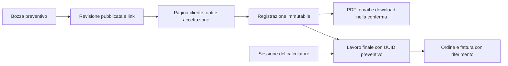

# Accettazione dei preventivi CAD e servizi — piano tecnico

Stato: implementato e verificato, 27 ottobre 2026. Il piano seguente conserva i requisiti concordati; le convenzioni applicate sono documentate nei README backend/frontend.

## Requisiti concordati

- Il back-office prepara un preventivo e condivide un link.
- Il cliente apre una pagina dedicata, inserisce i dati e accetta il preventivo.
- Il sistema conserva chi ha dichiarato di accettare, quando e quale contenuto ha accettato.
- Dopo l'accettazione viene creato un **PDF con il contenuto del preventivo accettato**, allegato all'email di conferma. Nella schermata immediatamente successiva il cliente può scaricarlo; riaprire il sito in futuro non dà accesso al documento. Dal back-office restano disponibili consultazione, download e reinvio.
- Il preventivo contiene **una sola voce descrittiva**, con **stima a ore oppure a corpo**. Non replica il dettaglio di una fattura.
- Ogni preventivo permette un **margine massimo di aumento personalizzabile**, espresso in **percentuale oppure CHF**.
- Nel lavoro finale si può collegare un **UUID preventivo**, accanto al collegamento esistente alla sessione del calcolatore. Il riferimento prosegue nell'ordine e nella fattura finale.
- I testi legali iniziali sono una bozza versionata, da rivedere separatamente. Il lavoro qui pianificato riguarda il funzionamento tecnico.

L'accettazione non crea un ordine, non richiede pagamento e non modifica gli stati di pagamento esistenti. Il consuntivo rimane nel flusso attuale di fatture e servizi.

## Riferimenti verificati nel repository

| Area | Implementazione da estendere o riusare |
| --- | --- |
| Gestione lavori CAD/servizi | `frontend/src/app/features/admin/pages/admin-cad-invoices.component.*`, `AdminOperationsController`, `AdminOperationsControllerService` |
| Lavoro finale e sessione di stampa | `QuoteSession`, `AdminCadInvoiceCreateRequest`, `AdminCadInvoiceDto`; `calculatorSessionId` è già distinto dall'identità della fattura |
| Calcoli e righe finali | `ServiceLineDto`, `QuoteSessionTotalsService`; supportano righe orarie/fisse, arrotondate ai centesimi |
| Creazione ordine | `OrderService.createOrderFromQuote`: lock della sessione, associazione `Order.sourceQuoteSession`, copia dei dettagli concordati |
| Link riprendibili | `QuoteSessionEmailService`, `OrderInformationService`, pagina checkout; accesso da un altro dispositivo e risposte delle credenziali senza cache |
| Registrazione consensi | `LegalConsent`, `LegalConsentService`, `LegalConsentRequestService`; timestamp server, versioni e IP risolto con la policy proxy esistente |
| Email | `EmailNotificationService.sendEmailWithAttachment`, `EmailAuditService`, `EmailLog`, listener dopo commit e frammenti `templates/email/fragments/layout.html` |
| Documenti | `InvoicePdfRenderingService`, `InvoiceLanguage`, `templates/invoice.html` |
| UI | Controlli condivisi, `app-legal-consent`, `app-dialog`, primitive `ui-*`, traduzioni IT/EN/DE/FR |
| Cancellazione e conservazione | `SessionCleanupService`, cancellazione sessioni e gestione `CAD_DELETED` nel servizio admin |

Le etichette attuali cliente/progetto sono raggruppamenti amministrativi, non un'anagrafica verificata del destinatario. L'attuale `LegalConsent` appartiene obbligatoriamente a un ordine o a una richiesta di contatto: non può rappresentare da solo questa nuova accettazione.

## Flusso previsto

1. In “Fatture e servizi” si apre la gestione preventivi e si crea una bozza con titolo, descrizione unica, prezzo/stima, margine, lingua e validità. Cliente/progetto restano gli stessi raggruppamenti amministrativi già usati.
2. “Pubblica e copia link” congela una revisione e rende disponibile la pagina cliente. “Invia email” usa la stessa revisione pubblicata e registra separatamente l'esito dell'invio.
3. Il cliente vede descrizione, metodo di stima, importo stimato, aumento massimo consentito e importo massimo risultante. Inserisce i dati, seleziona le conferme richieste e preme “Accetta preventivo”.
4. Il server registra l'accettazione in un'unica transazione. Dopo commit genera e conserva il PDF della revisione accettata, con i dati dichiarati e la data di accettazione, e lo allega alla ricevuta email. Nella schermata di conferma il cliente può scaricare lo stesso documento tramite un'autorizzazione temporanea legata a questo passaggio. Il back-office mostra stato, dati, documento ed esito email; rimane possibile scaricare e reinviare il PDF anche in seguito.
5. A lavoro concluso, l'operatore crea o modifica la fattura CAD/servizi e inserisce l'UUID preventivo, oppure usa “Crea lavoro da preventivo accettato”. Il collegamento alla sessione del calcolatore resta indipendente.
6. Il lavoro finale mantiene le righe dettagliate già disponibili. Alla creazione dell'ordine vengono congelati anche i riferimenti al preventivo accettato; ordine e PDF li espongono come riferimento.



## Contenuto economico: una voce e un margine

Non usare `List<ServiceLineDto>` per il nuovo preventivo. Riutilizzare convenzioni monetarie, validazione e controlli UI, mantenendo un modello dedicato alla stima unica.

| Campo | Regola |
| --- | --- |
| `description` | Unico ambito del lavoro, obbligatorio; testo semplice, senza HTML utente |
| `pricingMode` | `HOURLY_ESTIMATE` oppure `LUMP_SUM_ESTIMATE` |
| `estimatedHours`, `hourlyRateChf` | Obbligatori nel modo a ore, con precisione e limiti coerenti con le righe servizi esistenti |
| `estimatedAmountChf` | A ore: calcolato dal server. A corpo: importo inserito dall'operatore |
| `variationType` | `PERCENTAGE` oppure `AMOUNT_CHF` |
| `variationValue` | Obbligatorio e non negativo; zero significa nessun aumento incluso nel margine |
| `maximumAmountChf` | Calcolato dal server e salvato nella revisione |
| `currency` | CHF nella prima versione |
| `validUntil` | Scadenza esplicita dell'offerta; non si rinnova aprendo il link |

Calcolo con `BigDecimal` e `HALF_UP` ai centesimi:

- Ore: `stima = round(oreStimate × tariffaOraria, 2)`.
- Corpo: `stima = importoInserito`.
- Margine percentuale: `massimo = stima + round(stima × percentuale / 100, 2)`.
- Margine CHF: `massimo = stima + margineChf`.

Esempi: 10 h × CHF 80 = CHF 800; +15% porta il massimo a CHF 920. Una stima a corpo di CHF 500 con margine CHF 100 porta il massimo a CHF 600.

La pagina deve chiamare gli importi “stima” e “massimo con variazione”, mostrando la formula a ore quando pertinente. Il margine riguarda l'importo, non autorizza automaticamente modifiche alla descrizione del lavoro o alla tariffa. Per il confronto con il consuntivo, il perimetro proposto è prestazioni e prodotti del lavoro, inclusi costi di preparazione; spedizione esclusa e indicata esplicitamente. Qualsiasi diversa inclusione deve essere resa esplicita prima della pubblicazione.

Il massimo è sempre salvato con la revisione: modificare una configurazione globale non cambia un preventivo già accettato. Validare anche overflow del totale risultante e campi incompatibili con il metodo scelto; non fidarsi dei totali inviati dal browser.

## Modello dati proposto

Usare entità dedicate, con nome `ServiceQuote` per distinguere il preventivo commerciale dalla `QuoteSession` tecnica già esistente.

### `ServiceQuote` / `service_quotes`

- UUID stabile `quoteId`, creato dal server.
- Etichette amministrative cliente/progetto e riferimento facoltativo alla richiesta di contatto esistente.
- Puntatore alla revisione corrente, date di creazione/aggiornamento e versione per concorrenza ottimistica.
- Archivio amministrativo senza cancellazione dello storico pubblicato o accettato.

### `ServiceQuoteRevision` / `service_quote_revisions`

- UUID di revisione, FK al preventivo e numero progressivo; vincolo univoco `(quote_id, revision_number)`.
- Titolo, descrizione unica, campi economici sopra elencati, lingua e scadenza. Email, anagrafica e indirizzo vengono inseriti dal cliente nella pagina pubblica prima dell’accettazione e del download.
- Copia esatta dei testi di accettazione mostrati e identificativi delle relative versioni. Il contenuto pubblicato è immutabile.
- `publishedAt`, eventuali `revokedAt` / `supersededAt` e timestamp di creazione.
- Le bozze sono modificabili; una modifica a un contenuto pubblicato produce una nuova revisione.

Stati esposti dai DTO: `DRAFT`, `PUBLISHED`, `ACCEPTED`, `EXPIRED`, `REVOKED`, `SUPERSEDED`. `ACCEPTED` deriva dall'accettazione registrata; `EXPIRED` dalla scadenza server. Evitare flag o stati duplicati che possono contraddirsi. Una revisione già accettata conserva tale esito anche dopo scadenza o pubblicazione di una successiva.

### `ServiceQuotePublicLink` / `service_quote_public_links`

- UUID casuale distinto da `quoteId` e `revisionId`, associato a una sola revisione.
- Data di creazione e revoca, credenziale applicativa dedicata e scadenza coerente con la revisione.
- Link proposto: `/{lang}/quotes/{publicLinkId}`. Riusare lo stesso link per copia e invio; un'esplicita rigenerazione revoca il precedente.

Il link identifica deliberatamente una condivisione e permette di aprire l'offerta senza account. Non riutilizzare l'UUID interno come autorizzazione, né le credenziali di ordini o istruzioni. Riprendere il modello esistente di `resume`: restituzione di una credenziale dedicata senza cache, poi accesso tramite header, senza token aggiuntivi in query string o fragment. Il possesso del link consente la presentazione e l'accettazione dell'offerta, non prova l'identità del destinatario.

### `ServiceQuoteAcceptance` / `service_quote_acceptances`

- UUID, FK alla revisione e vincolo univoco sulla revisione: una sola accettazione.
- Timestamp UTC del server; nessun timestamp probatorio fornito dal client.
- Snapshot di email, tipo cliente, nome/cognome oppure ragione sociale e persona referente, indirizzo di fatturazione, telefono facoltativo e lingua.
- Conferma esplicita del preventivo, termini/privacy, relative versioni e riferimento alla revisione economica immutabile.
- IP tramite `LegalConsentRequestService`, seguendo la configurazione proxy esistente; nessuna raccolta aggiuntiva di user agent.
- Nessuna API di modifica dell'accettazione. Le successive modifiche del cliente nell'ordine non riscrivono lo snapshot.

Adottare DTO nuovi con validazione annidata: gli attuali `CustomerDto` e `AddressDto` non hanno da soli i vincoli necessari. Riutilizzarne forma e convenzioni solo dove appropriate. Non creare o aggiornare automaticamente il cliente globale per il semplice invio dell'accettazione.

L'entità dedicata registra l'intera dichiarazione e riusa risoluzione IP e convenzioni di versione dei consensi esistenti. Non modificare il vincolo di appartenenza di `LegalConsent`; il successivo checkout continua a registrare il proprio consenso all'ordine.

### `ServiceQuoteDocument` / `service_quote_documents`

- UUID, FK univoca all'accettazione e riferimento alla revisione esatta da rappresentare.
- Stato operativo `PENDING`, `READY` o `FAILED`, date di generazione, versione del template, chiave dello storage privato, nome file, dimensione e hash SHA-256 del PDF.
- Il contenuto deriva esclusivamente dagli snapshot accettati; l'IP di audit e le credenziali non sono inclusi nel PDF.
- Una volta pronto, conservare il file originale: download e reinvio leggono gli stessi byte, senza rigenerarlo dai dati correnti.
- Stato operativo e tentativi di elaborazione rimangono separati dal record immutabile dell'accettazione. Un errore di rendering non annulla quanto il cliente ha già accettato.

Registrare separatamente l'autorizzazione temporanea al download, con credenziale casuale memorizzata come hash, accettazione/documento consentiti e scadenza assoluta. Non ricavarla dall'UUID del preventivo o dal link pubblico.

## Pubblicazione, revisioni e concorrenza

- Pubblicazione: validare tutti i campi, calcolare e congelare gli importi, associare la versione dei testi, creare il link nella stessa transazione.
- Nuova revisione pubblicata: rendere non accettabili le revisioni precedenti ancora pendenti e revocarne i link. Una revisione già accettata resta consultabile nello storico amministrativo.
- Pagina aperta prima di una modifica: l'invio specifica `revisionId` e versione del contenuto; se sostituita, scaduta o revocata il server rifiuta e la UI chiede di aprire il nuovo link. Nessuna accettazione silenziosa dell'ultima versione.
- Accettazione: lock della revisione e verifica del link; controlli, inserimento e transizione atomici. Anche revoca e sostituzione devono acquisire i lock nello stesso ordine.
- Doppio clic/retry: chiave di idempotenza del submit e vincolo univoco. Lo stesso invio riceve lo stesso identificativo di conferma; dati diversi dopo un'accettazione danno conflitto e non riscrivono il record.
- Email di invito e ricevuta sono effetti separati: fallire SMTP non annulla una pubblicazione o un'accettazione già salvata. Mostrare l'esito corretto e consentire il reinvio amministrativo.
- Nella transazione di accettazione creare anche il documento in stato `PENDING` e l'autorizzazione temporanea. Il rendering avviene dopo commit; inviare la ricevuta con allegato soltanto quando il PDF è pronto. Recuperare elaborazioni interrotte dagli stati persistiti senza duplicare accettazioni o documenti.

## API indicative

I nomi seguenti sono contratti proposti, non endpoint già presenti. Controller sottili, DTO pubblici/admin separati e regole nei servizi.

| Endpoint | Funzione |
| --- | --- |
| `GET /api/admin/service-quotes` | Elenco con cliente/progetto, revisione, importi e stato |
| `POST /api/admin/service-quotes` | Crea preventivo con bozza iniziale |
| `GET /api/admin/service-quotes/{quoteId}` | Dettaglio, revisioni, accettazioni, lavori collegati e invii |
| `PUT /api/admin/service-quotes/{quoteId}/draft` | Salva una bozza con controllo versione; non modifica una revisione pubblicata |
| `POST /api/admin/service-quotes/{quoteId}/publish` | Pubblica la bozza e restituisce il link |
| `POST /api/admin/service-quotes/{quoteId}/revisions/{revisionId}/email` | Invia o reinvia il link pubblicato |
| `POST /api/admin/service-quotes/{quoteId}/revisions/{revisionId}/revoke` | Revoca una proposta ancora pendente |
| `GET /api/admin/service-quotes/{quoteId}/revisions/{revisionId}/pdf-preview` | Anteprima del contenuto, anche in bozza; distinguere le bozze dai documenti accettati |
| `GET /api/admin/service-quotes/{quoteId}/acceptances/{acceptanceId}/pdf` | Scarica il PDF archiviato dell'accettazione, anche in futuro |
| `POST /api/admin/service-quotes/{quoteId}/acceptances/{acceptanceId}/pdf-retry` | Ritenta una generazione fallita, senza modificare il contenuto accettato |
| `POST /api/admin/service-quotes/{quoteId}/acceptances/{acceptanceId}/receipt-email` | Reinvia la ricevuta con lo stesso PDF al destinatario registrato |
| `POST /api/service-quote-links/{publicLinkId}/resume` | Verifica link/stato/scadenza e restituisce credenziale limitata all'offerta |
| `GET /api/service-quotes/{quoteId}/revisions/{revisionId}` | Con credenziale, restituisce solo l'offerta condivisa |
| `POST /api/service-quotes/{quoteId}/revisions/{revisionId}/accept` | Con credenziale, registra e restituisce conferma, stato PDF e autorizzazione temporanea al download |
| `GET /api/service-quote-acceptances/{acceptanceId}/pdf-status` | Con autorizzazione temporanea, verifica se il documento è pronto nella schermata di conferma |
| `GET /api/service-quote-acceptances/{acceptanceId}/pdf` | Con autorizzazione temporanea in header, scarica il PDF; link pubblico e normale credenziale dell'offerta non sono sufficienti |

Le API admin mantengono sessione e CSRF esistenti. Le API pubbliche controllano esplicitamente la credenziale nel servizio: la configurazione attuale permette in generale le route non admin. Nessuna API pubblica deve esporre storico interno, IP o dati personali delle accettazioni precedenti. Riaperte dopo l'accettazione, le pagine mostrano soltanto uno stato generico, senza pulsante né autorizzazione per recuperare il PDF; i dati completi rimangono nell'area amministrativa e nel documento inviato al dichiarante. La sola schermata immediatamente successiva al submit dispone dell'autorizzazione temporanea.

Usare `no-store`, `noindex, nofollow` e policy referrer coerenti con una pagina privata condivisa. Non inserire link e credenziali in analytics o audit email. Applicare limiti ai tentativi pubblici e agli invii con i meccanismi esistenti; la visita al link non accetta nulla e non prolunga la validità. L’email viene dichiarata dal cliente e non è vincolata a un destinatario configurato nel back-office: la prima versione non include verifica OTP.

## Back-office e collegamento al lavoro finale

Mantenere la route attuale `admin/cad-invoices` come punto di accesso e gli stessi raggruppamenti cliente/progetto. Aggiungere gestione preventivi in una vista dedicata accessibile da quest'area, con componenti separati per evitare di espandere ulteriormente la pagina fatture.

- Elenco: titolo, UUID copiabile, revisione, metodo, stima, margine, massimo, scadenza, stato e azioni.
- Editor: descrizione unica; selettore ore/corpo; campi economici pertinenti; selettore %/CHF; riepilogo calcolato; lingua e validità. Nessuna tabella di righe fattura.
- Dettaglio: storico revisioni, copia link, invio/reinvio, stato email e dati dell'accettazione visibili solo agli amministratori.
- Documenti: anteprima del preventivo, apertura e download del PDF accettato, stato di generazione, ritenta in caso di errore e reinvio della ricevuta con allegato. Queste azioni restano disponibili anche quando il download pubblico è terminato e anche per le revisioni storiche accettate.
- Azione “Crea lavoro da preventivo accettato”: precompila collegamento e raggruppamenti. L'eventuale proposta di una riga servizi viene rivista dall'operatore prima del salvataggio.
- Nel modulo del lavoro finale, aggiungere “UUID preventivo” accanto a “UUID sessione”. Dopo la ricerca, mostrare titolo, revisione accettata, stima e massimo.

Estendere `QuoteSession` con un'associazione nullable `acceptedServiceQuoteRevision`, e DTO/modelli con `serviceQuoteId` per l'inserimento e `serviceQuoteRevisionId` per il riferimento preciso restituito dal server. Il backend risolve l'UUID e fissa la revisione accettata, senza selezionare silenziosamente tra più revisioni accettate: in quel caso richiede una scelta esplicita dalla UI.

Creazione, modifica e scollegamento seguono la semantica già usata per `calculatorSessionId`: omissione preserva l'associazione, `null` la rimuove, UUID la imposta dopo validazione. Associare solo una revisione accettata. La successiva accettazione di una nuova revisione non aggiorna automaticamente i lavori già collegati. Dopo conversione in ordine, bloccare modifiche al riferimento contrattuale come già avviene per i dettagli economici.

Alla creazione dell'ordine, copiare UUID preventivo, UUID/numero revisione e riferimento all'accettazione in un'associazione/snapshot dedicato dell'ordine. Estendere i DTO admin e pubblici con il solo riferimento necessario, quindi `InvoicePdfRenderingService`, `InvoiceLanguage` e il template fattura. Non esporre il link di accettazione nei documenti finali. Per i record precedenti, i campi null non producono etichette vuote.

Il collegamento è facoltativo per i lavori esistenti e non sostituisce `sourceRequestId`, `calculatorSessionId` o `Order.sourceQuoteSession`. Eliminare o ricreare una fattura con `CAD_DELETED` non deve eliminare l'offerta o la sua accettazione, né trasferire automaticamente il collegamento al nuovo contenuto del vecchio URL.

### Confronto con il consuntivo

Nella prima versione mostrare nel back-office stima, massimo accettato e scostamento del lavoro finale. Evidenziare il superamento e proporre una nuova revisione da far accettare; non trasformare automaticamente una stima in una maggiorazione.

**Limite esplicito di questo piano:** il margine viene salvato e mostrato, ma non introduce da solo un blocco automatico del checkout o una contabilità del budget tra acconti. Il sistema esistente permette più fatture per progetto: un confronto per singola fattura non dimostra che il totale complessivo sia entro il massimo. Consentire più lavori collegati e mostrarne l'elenco, distinguendo bozze e ordini senza contare due volte la stessa fattura. Se si vuole rendere il tetto un vincolo applicativo, serve una fase dedicata con totale cumulativo, trattamento di acconti/annullamenti e lock condiviso alla creazione dell'ordine. Non dichiarare tale controllo disponibile prima di averlo implementato.

## Pagina pubblica

Nuova feature Angular lazy-loaded sotto `features/service-quotes`, con route `/:lang/quotes/:publicLinkId` e servizio API tipizzato.

- Presentazione coerente con checkout e pagine pubbliche attuali, anche su mobile.
- Una descrizione del lavoro, calcolo della stima, margine e massimo ben visibili; nessun controllo per modificare quantità o colori di stampa.
- Form per privato/azienda e indirizzo; stesso vocabolario del checkout, controlli condivisi e validazione sia client sia server.
- Conferma del preventivo distinta dall'accettazione termini/privacy; riusare `app-legal-consent` per questi ultimi e `app-checkbox` per la dichiarazione specifica.
- Stati caricamento, link non disponibile, scaduto, sostituito, già accettato, errore validazione, invio in corso e conferma.
- Nella schermata successiva all'accettazione, mostrare “Scarica PDF” appena il documento è pronto, stato di preparazione ed esito invio email separati. Il download usa il servizio Angular con header e Blob; nessun URL permanente del file. Dopo la chiusura del passaggio o alla scadenza, il riferimento per il cliente è l'allegato email.
- Un errore email successivo al salvataggio non deve apparire come mancata accettazione. Nessuna compilazione automatica con dati di altri visitatori.
- Signals/AsyncPipe o aggiornamento esplicito OnPush, HTML/SCSS/TS separati, tastiera e focus coerenti con i componenti condivisi.

## PDF del preventivo e download dopo l'accettazione

Il documento contiene logo e dati dell'attività, titolo, UUID preventivo e numero revisione, descrizione unica, metodo ore/corpo con relativa formula, stima CHF, margine in % o CHF, massimo risultante, validità e testi accettati nella lingua della revisione. Aggiungere dati dichiarati dal cliente, data/ora dell'accettazione con fuso esplicito e riferimento all'accettazione. Mantenerlo distinto dalla fattura finale e senza QR di pagamento.

Riutilizzare il motore Thymeleaf/OpenHTMLToPDF e le convenzioni visive dell'attuale fattura, con un template preventivo dedicato e un servizio di rendering per il nuovo dominio. Non creare un ordine o un pagamento fittizi per usare `InvoicePdfRenderingService`. Se serve estrarre una capacità di rendering condivisa, mantenere invariati i documenti esistenti e verificarli contro il riferimento. Nomi file proposti: `preventivo-{quoteId}-r{revisionNumber}-accettato.pdf`.

**Accesso cliente limitato al passaggio successivo:** l'autorizzazione è restituita soltanto al completamento del submit, conservata in memoria nella pagina di conferma e valida per una breve finestra assoluta; proposta tecnica iniziale: 15 minuti dal commit. Non salvarla in URL, localStorage o sessionStorage. Entro la finestra sono consentiti attesa del rendering e retry del download; la scadenza non si prolunga con le richieste. Il download non è monouso, per evitare di perderlo in caso di rete interrotta.

Chiudere o ricaricare la pagina elimina l'autorizzazione dal browser. Riaprire il vecchio link, eseguire `resume` o ripetere un submit già concluso non rilascia una nuova autorizzazione né apre una nuova finestra; l'idempotenza resta limitata alla gestione del submit originale. Il backend rifiuta richieste senza autorizzazione, scadute o riferite a un'altra accettazione. Le risposte PDF usano `application/pdf`, `Content-Disposition: attachment` e `Cache-Control: no-store`; i file rimangono nello storage privato, senza URL statici pubblici.

Questa limitazione riguarda l'accesso futuro sul sito: il cliente conserva liberamente la copia scaricata o ricevuta per email. In caso di problema successivo, il back-office può scaricare o reinviare il documento. Non prevedere un archivio documenti pubblico né un endpoint pubblico per richiedere il reinvio.

Se rendering o invio falliscono, mantenere l'accettazione, registrare l'errore e mostrare i due esiti distinti. Il back-office può ritentare la generazione o reinviare l'allegato senza riaprire l'accesso pubblico. I retry sul documento già pronto riusano il file archiviato; eventuali correzioni di contenuto passano da una nuova revisione, senza sovrascrivere l'originale.

## Email e testi provvisori

Prevedere invito, ricevuta cliente e notifica amministrativa di accettazione. L'invito contiene il link alla proposta; la ricevuta successiva all'accettazione allega il PDF completo tramite `EmailNotificationService.sendEmailWithAttachment`, già disponibile nel repository. Il file allegato coincide con quello scaricabile nella conferma e conservato nel back-office. L'email non contiene un link permanente di download. Riutilizzare SMTP e frammenti Thymeleaf esistenti, in IT/EN/DE/FR. Estendere `EmailLog` con riferimento nullable al preventivo/revisione e al documento, scope ed eventi dedicati; includere nella vista admin solo metadati, nome allegato ed esiti, senza credenziali o byte PDF.

Emettere gli eventi nella transazione e inviare dopo commit. Mantenere i confini dell'audit `REQUIRES_NEW`; nessun invio prima che i riferimenti esistano nel database. Usare i normali esiti inviato/fallito/disabilitato e reinvio esplicito; la prima versione non promette consegna SMTP garantita in caso di arresto del processo.

Bozza di dichiarazione, da revisionare: «Accetto il preventivo [riferimento e revisione] per il lavoro descritto, con importo stimato CHF [stima] e variazione massima [margine], fino a CHF [massimo].» Conservare il testo esatto mostrato, lingua e versione con la revisione pubblicata. Le modifiche successive ai testi non riscrivono lo storico.

Questa è una registrazione tecnica dei dati dichiarati e dell'azione sul link. Non attribuire al sistema verifica dell'identità o firma qualificata. La redazione definitiva delle clausole, la pubblicazione dei testi finali e i tempi di conservazione restano attività da completare prima del rilascio pubblico.

## Schema e compatibilità

- Migrazione additiva: nuove tabelle di dominio, metadati dei documenti e autorizzazioni temporanee, FK nullable su `quote_sessions`, `orders` ed `email_logs`, indici e vincoli univoci. Allineare entità e DDL idempotente in `db.sql` con `ddl-auto=update`.
- Nessun backfill di accettazioni: i lavori storici non diventano retroattivamente accettati.
- Bozze non pubblicate eliminabili; revisioni pubblicate/accettate archiviabili. Cancellazione di sessioni e pulizia file non devono cancellare i record di accettazione.
- Il preventivo conserva il proprio contenuto indipendentemente dalle sessioni di slicing. Nessun FK obbligatorio verso modelli o file temporanei e nessun ricalcolo slicer per aprire/accettare il link.
- I PDF sono conservati nello storage privato con i relativi snapshot, indipendentemente dalla durata dell'accesso cliente. La pulizia delle autorizzazioni scadute non elimina documenti o accettazioni; includere file e metadati nelle procedure di backup/ripristino esistenti.
- La prima versione non include upload dedicati al preventivo: descrizione, stima e dichiarazione sono autosufficienti. I file del lavoro restano nei flussi esistenti.
- Non introdurre dipendenze o servizi esterni per questa funzionalità. Applicare la policy del repository se l'implementazione ne rendesse necessaria una.

## Sequenza di implementazione

1. **Dominio e persistenza:** entità, DTO validati, calcolo unico e margine, stati, DDL, snapshot e test di persistenza. Risultato: contratto economico a una voce verificabile.
2. **API amministrative:** bozze, pubblicazione, revisioni, scadenza, revoca e link. Risultato: preventivo pubblicabile senza UI nuova.
3. **Accettazione pubblica backend:** autorizzazione dedicata, form DTO, accettazione atomica, idempotenza, documento pendente e autorizzazione temporanea al download. Risultato: accettazione registrabile e consultabile dall'admin.
4. **UI back-office:** gestione preventivi nell'area CAD/servizi, editor singolo, margine %/CHF e dettaglio accettazione; azioni per anteprima, download, retry e reinvio PDF. Risultato: preparazione, condivisione e gestione documenti complete.
5. **Pagina cliente:** form, riepilogo immutabile, consensi e tutti gli stati; download PDF limitato alla conferma immediata, traduzioni allineate. Risultato: percorso completo da link a conferma.
6. **PDF ed email:** template preventivo, rendering dopo commit, archivio privato, recupero elaborazioni fallite, download temporaneo, invito, ricevuta con allegato, notifica admin e audit. Verificare visivamente PDF e template email renderizzati. Risultato: documento identico via email/download/back-office e invii osservabili e reinviabili.
7. **Lavoro finale e documenti:** UUID preventivo nel modulo, associazione alla revisione, snapshot ordine, confronto informativo e riferimento nel PDF. Risultato: tracciabilità completa.
8. **Validazione e documentazione:** E2E su stack locale usa e getta, verifica layout, README backend/frontend e link dai rispettivi AGENTS. Prima del rilascio completare la revisione dei testi provvisori.

Ogni fase deve mantenere funzionanti i flussi esistenti. Nessuna migrazione di pagamento, nessun nuovo stato ordine per rappresentare l'accettazione e nessuna operazione di deploy prevista da questo piano.

## Verifica e criteri di completamento

Test mirati prima dei controlli generali:

- Ore/corpo, margine percentuale/CHF/zero, arrotondamenti e limiti: importi esatti attesi, campi incompatibili rifiutati e massimo non falsificabile dal client.
- Snapshot e persistenza: pubblicato non modificabile, vecchio testo e vecchi importi conservati dopo nuova revisione.
- API admin: autenticazione, CSRF, validazione e concorrenza tra editor.
- API pubbliche: credenziale mancante/errata/revocata, scadenza, lingua e assenza di PII/audit nei DTO pubblici.
- Accettazione: timestamp e IP server, dati obbligatori, checkbox false rifiutate, rollback senza record parziali, doppio clic/retry e due invii simultanei.
- Corse accettazione/revoca/sostituzione: nessuna accettazione di una versione resa indisponibile prima del commit.
- SMTP fallito/disabilitato: accettazione conservata e stato UI corretto; nessuna notifica per transazioni annullate.
- PDF: contenuto esatto dello snapshot, identità dei byte tra allegato/download/archivio, lingua, margine, massimo, dati e data di accettazione; rendering multipagina senza tagli con descrizioni lunghe. Verificare visivamente il PDF e confrontarne lo stile con la fattura esistente.
- Accesso temporaneo: download e retry nella conferma originale; rifiuto con token assente/scaduto o di un'altra accettazione; riapertura link, refresh, `resume` e submit ripetuto non riattivano il download. Nessuna credenziale in URL o storage browser e nessuna cache pubblica.
- Errori rendering e arresti dell'elaborazione: accettazione conservata, stati recuperabili, niente email dichiarata inviata senza allegato; retry e reinvio dal back-office senza nuova accettazione né nuovo accesso pubblico.
- Archivio admin: consultazione, download e reinvio dopo la scadenza pubblica e per revisioni storiche; cleanup delle autorizzazioni senza perdita dei PDF.
- Associazione finale: omissione/null/UUID, scelta della revisione, impossibilità di modificare un ordine già emesso, vecchi lavori senza associazione ancora funzionanti.
- Cancellazione/rimpiazzo fattura e cleanup sessioni: storico preventivo e accettazione conservati.
- Documenti: riferimento corretto, tradotto, presente anche con descrizioni lunghe; assente per i record storici. Render PDF con controllo visivo secondo le convenzioni del repository.
- E2E reale: admin crea e pubblica → browser cliente nuovo accetta → nella conferma scarica il PDF e riceve lo stesso allegato nell'SMTP locale → riapre il link senza poter riscaricare → admin scarica/reinvia il PDF e collega UUID al lavoro → ordine e fattura mantengono il riferimento. Coprire entrambi i modi di stima e di margine senza slicing reale né email esterne.
- UI: mobile, tastiera, testi lunghi, aggiornamento asincrono, link riaperto dopo accettazione e tentativo con pagina rimasta aperta dopo una revisione.

Comandi da eseguire durante l'implementazione, con test mirati prima delle suite complete:

```bash
cd backend
./gradlew test

cd ../frontend
npx tsc -p tsconfig.app.json --noEmit
npm run check:i18n
npm run check:ui-reuse
npm run check:e2e-routes
```

Eseguire i test frontend interessati e l'E2E sullo stack monouso secondo `frontend/e2e/README.md`. Aggiornare manifest delle route e piano di copertura. Eseguire `node scripts/check-external-packages.mjs` secondo la policy del progetto. Nessuna di queste suite viene dichiarata eseguita con la sola stesura del piano.

Il risultato è completo quando un operatore può ritrovare, dal lavoro finale, il preventivo e la revisione accettati con dati dichiarati, data, stima e margine originali, anche se il consuntivo e i testi correnti sono cambiati. Il cliente riceve il PDF per email e può scaricarlo nella conferma immediata, senza accesso futuro dal vecchio link; il back-office conserva consultazione, download e reinvio del documento originale.

## Note di implementazione

- Il riferimento commerciale nel lavoro e nell'ordine è una copia JSON immutabile con UUID del preventivo, revisione e accettazione, validata dal servizio; il lavoro conserva anche l'UUID scalare per ricerca. Non aggiunge una dipendenza JPA obbligatoria alle sessioni precedenti.
- Hash e scadenza dell'autorizzazione temporanea sono registrati sull'accettazione, senza tabella di grant separata. Il browser genera il segreto prima dell'invio e lo mantiene soltanto in memoria; il retry dello stesso submit non prolunga la scadenza.
- La persistenza del documento pendente permette il recupero dopo commit tramite evento e processo periodico. Errori PDF e SMTP sono distinti e gestibili dal back-office.
- La creazione del lavoro precompila una riga modificabile usando il titolo del preventivo; la descrizione completa rimane nel documento accettato.
- I testi di dichiarazione restano una bozza da revisionare. Il superamento del massimo è informativo, come previsto nel perimetro iniziale.

## Verifiche eseguite

- Compilazione backend, build Angular browser/server e controlli TypeScript applicazione, test ed E2E.
- Suite backend: 592 passati e un test live ClamAV condizionale non eseguito; suite frontend: 252 passati, inclusi i casi mirati di identità, retry, concorrenza, versioni, persistenza, collegamento al lavoro e recupero da errore PDF/SMTP.
- Cinque scenari Playwright su stack Docker monouso con PostgreSQL e Mailpit: due regressioni del ciclo CAD, percorso completo ore/% e corpo/CHF, protezione admin. Risultato: 5 passati. Nessuna email esterna o slicing reale.
- PDF in tutte le lingue e verifica visiva di documento normale e multipagina; confronto dei byte tra download, allegato SMTP e archivio.
- Parità traduzioni, riuso UI, inventario delle route e controllo pacchetti esterni: 45/45 metadati verificati. Nessuna dipendenza cambiata.

L'implementazione non è stata distribuita. I testi provvisori e il confronto informativo col massimo mantengono i limiti di perimetro descritti sopra.

### Precompilazione checkout CAD

Il link condiviso dal back-office per un lavoro collegato a un preventivo accettato
precompila email, tipo cliente, nome/cognome o azienda/referente, indirizzo e telefono
se presente. I dati restano modificabili; il consenso all’ordine va confermato di
nuovo. Indirizzo di spedizione uguale alla fatturazione per impostazione iniziale.
Un token separato nel fragment del link autorizza una risposta dedicata senza cache:
nessun dato personale viene aggiunto alle normali risposte pubbliche della sessione.
Le modifiche al checkout non alterano l’accettazione originale. Se il telefono non
è stato indicato all’accettazione, resta da completare al checkout.
